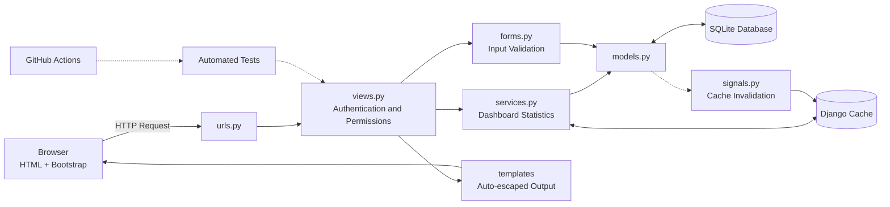

# Study Planner – Personal Study Management System

## 1. Project Overview

Study Planner is a web application that helps university students organise their study tasks. Students can create an account, record tasks with due dates and priorities, and track their progress through a dashboard. Each student can access only their own data.

The system is an individual university project developed using Python, Django, Bootstrap 5, and SQLite. It also applies concepts from CS50 Web Week 7 (Testing and CI/CD) and Week 8 (Scalability and Security).

**Target Users:** University students who need a simple and private tool to manage assignments, deadlines, and study progress.

## 2. Problem Statement

University students often manage multiple courses and assignments simultaneously. Deadlines and task information may be scattered across notes, chat messages, and personal reminders. As a result, students may forget assignments, struggle to prioritise their work, or find it difficult to track their overall progress.

Study Planner addresses these problems by providing a centralised platform where students can organise tasks, set priorities, monitor deadlines, identify overdue work, and review their progress through dashboard statistics.

## 3. Project Objectives

- Provide a simple study task management system with user registration and authentication.
- Allow students to create, view, edit, delete, and complete their own tasks.
- Help students organise tasks using priorities and deadlines.
- Provide search and filtering functionality for easier task management.
- Display study progress through dashboard statistics.
- Protect user information through authentication, authorisation, input validation, XSS protection, and CSRF protection.
- Apply CS50 Web Week 7 and Week 8 concepts and distinguish between implemented, demonstrated, and documented features.

## 4. Main Features

- **User Authentication:** Registration, login, and logout using Django's built-in authentication system.
- **Task Management:** Add, view, edit, and delete study tasks.
- **Task Completion:** Mark tasks as completed.
- **Task Priorities:** Assign Low, Medium, or High priority.
- **Task Search:** Search tasks by title.
- **Task Filtering:** Filter tasks by status, priority, and overdue status.
- **Dashboard:** Display total tasks, completed tasks, pending tasks, overdue tasks, and completion percentage.
- **User Data Isolation:** Each user can access and manage only their own tasks.

## 5. Technologies Used

| Technology | Role in the Project |
|---|---|
| Python 3 | Main programming language for the backend and tests. |
| Django 5.2 | Web framework for URL routing, views, forms, authentication, ORM, and testing. |
| Bootstrap 5 | Provides responsive layouts and user interface components. |
| HTML and CSS | Used to create Django templates and custom page styling. |
| SQLite | File-based database for storing user and task information. |
| Selenium | Browser automation for an end-to-end testing scenario. |
| GitHub Actions | Automates project checks and tests through a CI workflow. |
| Docker | Packages the application into a container image. |
| Nginx | Provides a reverse proxy and load-balancing demonstration. |
| Gunicorn | Production WSGI server used in the Docker configuration. |
| WhiteNoise | Serves static files in the Docker configuration. |

## 6. System Architecture

Study Planner follows Django's Model–View–Template (MVT) architecture. Business logic and dashboard statistics are separated into `planner/services.py`, allowing them to be tested and cached independently of the web views.



**Main Components**

- **Frontend:** Server-rendered Django templates styled with Bootstrap 5. No JavaScript framework is required.
- **Backend:** Django views handle requests, forms validate user input, and services calculate dashboard statistics.
- **Database:** SQLite stores user and task information. Each task is associated with its owner through a foreign key.
- **Caching:** Dashboard statistics are stored temporarily to reduce repeated database queries.
- **Testing:** Django tests cover application functionality and security, while Selenium tests a browser-based scenario.
- **CI:** GitHub Actions is configured to execute automated checks and tests.

For more details, see [System Architecture](docs/ARCHITECTURE.md).

## 7. CS50 Web Course Integration

This section explains how Study Planner applies concepts from CS50 Web Week 7 and Week 8. The statuses follow the classification used in [`docs/ARCHITECTURE.md`](docs/ARCHITECTURE.md) and [`docs/WEEK8.md`](docs/WEEK8.md).

**Implementation Status Definitions**

| Status | Meaning |
|---|---|
| Implemented | The functionality is implemented in the project source code. |
| Demonstrated | A separate example or demonstration exists but is not integrated into the main application. |
| Documented | The concept is explained in documentation but is not implemented. |
| Not Implemented | The concept is not present in the project. |

The statuses below reflect the project's source files and configuration. Execution and deployment status are identified separately where relevant.

### 7.1 Week 7 – Testing and CI/CD

Week 7 focuses on software testing, test-driven development, continuous integration, and development workflows.

| CS50 Concept | Application in Study Planner | Related File(s) | Implementation Status |
|---|---|---|---|
| Test-Driven Development (TDD) | Tests exist for the functions in `services.py`, and the overdue-task logic is documented as a red → green → refactor example. The original development sequence was not recorded. | `planner/tests/test_services.py`, `planner/services.py`, `docs/WEEK7.md`, `TESTING.md` | Implemented (process shown in docs) |
| Unit Testing | Tests check completed and pending task counts, completion percentage, overdue rules, and dashboard statistics. | `planner/tests/test_services.py` | Implemented |
| Django Testing | Tests cover registration, login/logout, task management, dashboard functionality, permissions, data isolation, search, and filters. | `planner/tests/test_views.py`, `planner/tests/helpers.py` | Implemented |
| Selenium Browser Testing | One end-to-end test uses headless Chrome to log in, open the Add Task page, save a task, and verify that it appears. | `planner/tests/test_selenium.py` | Implemented (needs Chrome; skipped otherwise; browser execution not verified) |
| Continuous Integration (CI) | GitHub Actions is configured to install dependencies, run Django system checks, and execute the test suite on pushes and pull requests. | `.github/workflows/tests.yml` | Implemented (runs after pushing to GitHub; successful execution not yet verified) |
| Docker | A Dockerfile packages the application, applies migrations, and starts Gunicorn. | `Dockerfile`, `.dockerignore`, `requirements.txt` | Implemented (files prepared; image build not yet verified) |

### 7.2 Week 8 – Scalability and Security

Week 8 introduces concepts that help web applications improve performance, security, and scalability.

| CS50 Concept | Application in Study Planner | Related File(s) | Implementation Status |
|---|---|---|---|
| Caching | Dashboard statistics are cached separately for each user for five minutes. Creating, editing, or deleting tasks invalidates the cached statistics. Tests verify cache hits, invalidation, and user separation. | `planner/services.py`, `planner/signals.py`, `config/settings.py`, `planner/tests/test_security.py` | Implemented |
| XSS Protection | Django's automatic template escaping prevents user-provided HTML and script content from being executed when displayed. | `templates/`, `planner/tests/test_security.py` | Implemented |
| CSRF Protection | Django's CSRF middleware protects POST requests. Forms include CSRF tokens, and tests verify rejection of requests without valid tokens. | `config/settings.py`, `templates/`, `planner/tests/test_security.py` | Implemented |
| HTTPS | Optional HTTPS settings (secure redirect, cookies, HSTS) are provided in `settings.py` but are disabled by default. No TLS certificate or HTTPS server is included, and local development uses plain HTTP. The importance of HTTPS and deployment steps are explained in the documentation. | `config/settings.py`, `docs/WEEK8.md` | Documented (configuration provided; not enabled or deployed) |
| Public-Key Cryptography | A separate educational RSA script demonstrates public/private keys, encryption, and digital signatures using small numbers. It is not used by the main application. | `scripts/public_key_demo.py`, `docs/WEEK8.md` | Demonstrated |
| Load Balancing | Docker Compose configures two application instances behind an Nginx round-robin load balancer. This is a classroom demonstration, not production infrastructure. | `docker-compose.yml`, `nginx/nginx.conf`, `docs/WEEK8.md` | Demonstrated (needs Docker to run; execution not yet verified) |
| Autoscaling | The documentation explains how monitoring server load can trigger the addition or removal of application instances. No autoscaling mechanism is configured. | `docs/WEEK8.md` | Documented |
| Database Replication | The documentation explains database replication. A separate backup script copies the SQLite database using its backup API, but this is a backup snapshot, not live replication. | `docs/WEEK8.md`, `scripts/backup_db.py` | Documented (backup script is a separate utility) |

**Summary of Course Integration**

The main application implements caching, XSS protection, CSRF protection, automated testing, and user data isolation. Public-key cryptography and load balancing are provided as separate demonstrations. HTTPS, autoscaling, and database replication are discussed in the documentation but are not part of the running application.

## 8. Testing

**Testing Strategy**

Study Planner uses several testing approaches to verify application functionality, business logic, and security.

- **Unit Testing:** Tests business logic independently, particularly dashboard calculations and overdue-task rules.
- **Django Testing:** Uses Django's test client to test pages, authentication, task management, and permissions.
- **Security Testing:** Checks caching, XSS escaping, and CSRF protection.
- **Browser Testing:** Uses Selenium to test a real browser interaction.
- **Continuous Integration:** GitHub Actions is configured to run automated checks and tests when code is pushed or a pull request is created.

**Test Results**

The project test suite contains 60 tests:

| Test Category | File | Number of Tests | Main Purpose |
|---|---|---:|---|
| Unit Tests | `test_services.py` | 12 | Dashboard statistics, task counts, completion percentage, and overdue rules. |
| Django Tests | `test_views.py` | 31 | Registration, login/logout, task management, dashboard, permissions, search, and filters. |
| Security and Caching Tests | `test_security.py` | 16 | Cache functionality, XSS escaping, and CSRF protection. |
| Selenium Browser Test | `test_selenium.py` | 1 | Login, add a task, and verify that the task appears in the browser. |
| **Total** | | **60** | |

**Verification Result:** In the reported verification environment, 59 tests passed and 1 Selenium test was skipped because Google Chrome was unavailable. The skipped test was not counted as a passed or failed test because it could not run in that environment.

The first three categories run in the Django test runner without a browser. The Selenium test starts a real browser and a live server. For test execution instructions, see [TESTING.md](TESTING.md).

## 9. Security

Study Planner includes several security measures to protect user accounts and task information.

**Implemented Security Measures**

- **Authentication:** Django's built-in authentication system manages user login and logout. Passwords are stored using Django's password-hashing mechanism.
- **Authorisation:** Task pages require authentication. Unauthenticated users are redirected to the login page.
- **User Data Isolation:** Task queries are restricted to the logged-in user. Users cannot access, edit, delete, or complete another user's tasks.
- **Input Validation:** Django forms validate task information, including titles, dates, priorities, and status values.
- **XSS Protection:** Django template auto-escaping helps prevent user-provided scripts from executing in rendered pages.
- **CSRF Protection:** Django's CSRF middleware and form tokens protect POST requests against cross-site request forgery.
- **Clickjacking Protection:** Django's default X-Frame-Options middleware provides protection against unauthorised framing.

**Security Limitations**

The project does not enable HTTPS enforcement by default and does not currently include login rate limiting or password reset functionality. These features are possible areas for future improvement.

## 10. Project Structure

```
study_planner/
├── manage.py
├── config/                      Project settings, root URLs, WSGI/ASGI
├── planner/
│   ├── models.py
│   ├── forms.py
│   ├── views.py
│   ├── services.py
│   ├── signals.py
│   ├── urls.py
│   ├── admin.py
│   └── tests/
│       ├── test_services.py
│       ├── test_views.py
│       ├── test_security.py
│       ├── test_selenium.py
│       └── helpers.py
├── templates/
├── static/css/
├── scripts/
│   ├── backup_db.py
│   └── public_key_demo.py
├── nginx/
├── docker-compose.yml
├── Dockerfile
├── .dockerignore
├── requirements.txt
├── .github/workflows/
│   └── tests.yml
├── docs/
│   ├── ARCHITECTURE.md
│   ├── WEEK7.md
│   ├── WEEK8.md
│   └── PRESENTATION.md
├── INSTALLATION.md
└── TESTING.md
```

**Important Files**

| File or Folder | Description |
|---|---|
| `manage.py` | Django command-line utility. |
| `config/` | Main project configuration and settings. |
| `planner/models.py` | Defines the Task database model. |
| `planner/forms.py` | Handles forms and input validation. |
| `planner/views.py` | Handles application pages and user requests. |
| `planner/services.py` | Contains dashboard statistics and caching logic. |
| `planner/signals.py` | Invalidates cached statistics when tasks change. |
| `planner/tests/` | Contains unit, Django, security, and Selenium tests. |
| `templates/` | HTML templates for the application. |
| `static/css/` | Custom CSS stylesheet. |
| `scripts/` | Database backup and educational cryptography examples. |
| `nginx/` | Nginx load-balancing configuration. |
| `.github/workflows/` | GitHub Actions CI workflow. |
| `docs/` | Additional project documentation. |

## 11. Limitations and Future Improvements

**Current Limitations**

- **Database:** SQLite has limited concurrent write capabilities and does not provide built-in live database replication.
- **Caching:** The project uses in-process LocMemCache, so multiple application servers would maintain separate cache instances.
- **Production Configuration:** Default settings are intended for development. Production deployment requires appropriate environment variables and security configuration.
- **HTTPS:** HTTPS enforcement is optional and is not enabled by default.
- **Scalability:** Autoscaling and live database replication are not implemented.
- **Load Balancing:** The Nginx and Docker Compose configuration is a demonstration and has not yet been verified through execution.
- **Docker:** The Docker image has not yet been built and verified in the project generation environment.
- **Browser Testing:** The Selenium test requires Google Chrome and was skipped in the reported verification environment.
- **Additional Features:** Password reset, login rate limiting, pagination, and task categories are not currently available.
- **External Dependency:** Bootstrap is loaded through a CDN, so the interface requires internet access to load Bootstrap assets.

**Future Improvements**

- Migrate from SQLite to PostgreSQL for better support of concurrent database operations.
- Introduce Redis for shared caching across multiple application instances.
- Deploy the application using HTTPS with a valid TLS certificate.
- Add password reset and login rate-limiting functionality.
- Implement pagination for users with large numbers of tasks.
- Add task categories and subject organisation.
- Verify the Docker and Nginx configurations through actual deployment.
- Include Docker-based testing in the CI workflow.

## 12. Documentation

The project includes additional documentation to explain its design, implementation, and relationship to CS50 Web.

| Document | Description |
|---|---|
| [ARCHITECTURE.md](docs/ARCHITECTURE.md) | System architecture, database design, and concept-to-file mapping. |
| [WEEK7.md](docs/WEEK7.md) | TDD, unit testing, Django testing, Selenium, GitHub Actions, and Docker. |
| [WEEK8.md](docs/WEEK8.md) | Caching, XSS, CSRF, HTTPS, public-key cryptography, load balancing, autoscaling, and replication. |
| [PRESENTATION.md](docs/PRESENTATION.md) | Presentation script and screenshot checklist. |
| [INSTALLATION.md](INSTALLATION.md) | Project installation, setup, Docker, and GitHub instructions. |
| [TESTING.md](TESTING.md) | Instructions for running the project tests. |

Study Planner demonstrates how a practical Django web application can combine personal study management with software testing, security, and scalability concepts learned in CS50 Web Week 7 and Week 8.